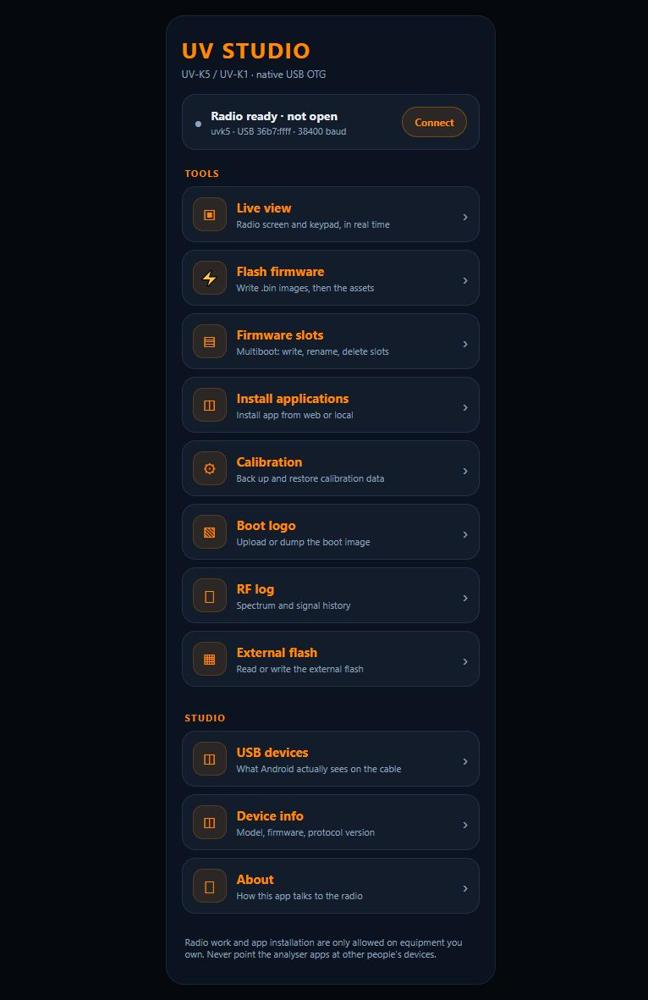
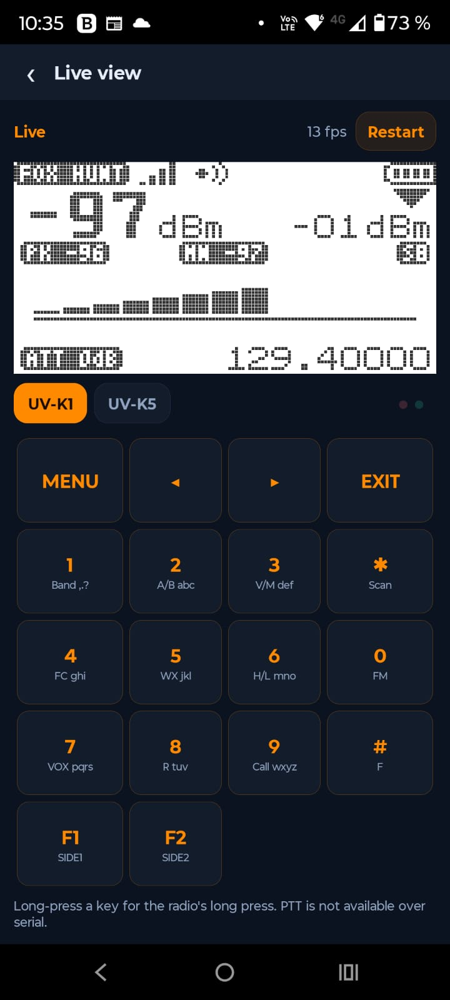

# UV Studio Mobile — native Android client

Independent native Android client **compatible with UV Studio** by
**Armel FAUVEAU (F4HWN)** for the Quansheng **UV-K1** and **UV-K5 V3**
handhelds. The phone talks to the radio directly over a USB-C OTG cable; there
is no WebView, no website and no server.

Made by **Claudiu Panga** (SmartReFleX) — https://github.com/SmartReFleX

> Independent project. The device protocol and the original web application are
> by Armel FAUVEAU (F4HWN), licensed under the Apache License 2.0. This Android
> client reimplements the protocol in Java and rebuilds the interface natively;
> changes were made. Unofficial community project, not tested or supported by
> F4HWN. Not affiliated with or endorsed by F4HWN or Quansheng.




> **Status: first public build (1.0.0), under community testing.** Firmware
> flashing, calibration writes and external-flash writes have not been validated
> outside my own radio. Back up the calibration data before writing anything.
> Provided as is, with no warranty; use it at your own risk.

## Features

| Screen | What it does |
| --- | --- |
| **Live view** | 128×64 radio screen drawn natively, full keypad with the secondary labels, LEDs, deep sleep, restart |
| **Flash firmware** | DFU flashing page by page, then the asset pack; local `.bin` or the firmware catalog |
| **Firmware slots** | Multiboot: list, write (local or catalog), erase, reset slot settings |
| **Install applications** | Overlay apps: list, install from a local `.app` or from the official + community catalogs, delete, renumber |
| **Calibration** | 512 B backup and restore (`calibration.dat`) |
| **Boot logo** | Read the logo to PNG, upload an image with threshold and invert |
| **RF log** | Live stream, table with aligned columns, CSV export |
| **External flash** | 2 MiB dump and sector-by-sector restore |
| **USB devices** | Diagnostic: everything Android sees on the bus |
| **Device info** | Firmware string, calibration offset, optional services |

The app works offline; only the firmware and app catalogs use the network.
Downloads are validated before anything is written (firmware package trailer,
app FAP1 header, community catalog apps by SHA-256).

## Install

1. Download `UV-Studio-Mobile-1.0.0.apk` from the **Releases** page.
2. Open it on the phone and allow installation from unknown sources.
3. Connect the radio with a **USB-C OTG** cable (the phone is the host).
4. Start the app, tap **Connect** and accept the Android USB permission.

For firmware flashing the radio must be in bootloader mode: hold **PTT**, power
it on (the screen stays dark), then plug the cable.

## Source

The full Java source is in this repository, under [`android-port/`](android-port).
No Gradle: the build script drives the Android SDK command line tools directly
(`aapt2`, `javac`, `d8`, `zipalign`, `apksigner`).

```
powershell -NoProfile -ExecutionPolicy Bypass -File .\android-port\build.ps1 -Clean
```

Output: `android-port/apk/UV-Studio-Mobile-1.0.0.apk`. Requirements: JDK 17,
Android SDK platform 35 and build-tools 35.0.0; `android-port/tools/get-toolchain.ps1`
fetches them into `%LOCALAPPDATA%\uvk-build`.

The signing keystore is **not** in the repository. The build generates a
throwaway one on first run; for a real release, point `UVSTUDIO_KS_FILE`,
`UVSTUDIO_KS_ALIAS` and `UVSTUDIO_KS_PASS` at your own key. The APK published in
Releases is signed with a private key that will never be committed.

## Requirements

- Quansheng UV-K1 or UV-K5 V3
- F4HWN firmware with the runtime serial protocol (Labs / Fusion)
- Android 7.0 or newer, USB-C OTG support

## Support

If this app is useful to you, you can buy me a coffee:
https://revolut.me/smartreflex

## Licence and credits

- **App code:** Apache-2.0 © 2026 Claudiu Panga.
- **Original work:** UV Studio (official web application) © 2026 Armel FAUVEAU (F4HWN), Apache-2.0,
  incorporating K5Viewer and UVTools2 © 2025 Armel FAUVEAU.
- Changes were made to the protocol adaptation. No part of the UV Studio web
  application is executed at runtime and no code from it is bundled with the
  app. Firmware and overlay apps are downloaded from their official repositories.

See [`LICENSE`](LICENSE) and [`NOTICE`](NOTICE).

## Safety

Use the app only on equipment you own. Flashing firmware, restoring calibration
and writing the external flash modify your radio — back up the calibration data
first. Transmitting may require a licence in your country.

No warranty of any kind. The author is not liable for any damage, data loss or
malfunction of the radio or of any other equipment caused by using this app.
Use it at your own risk.
